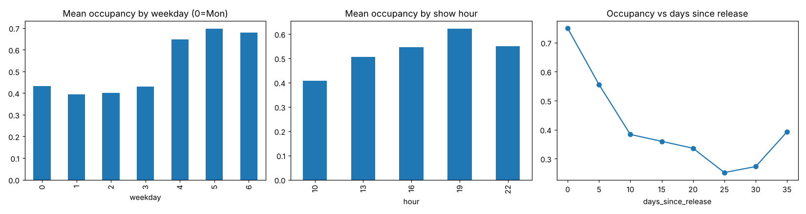
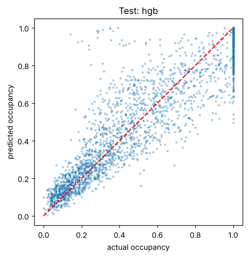
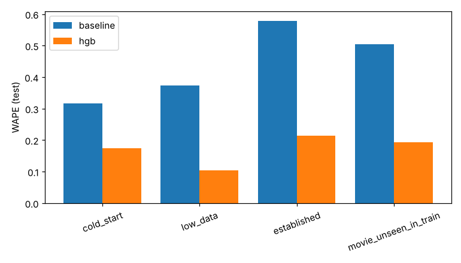

# Cinema Ticket Demand Forecasting - Technical Report

**Candidate:** Gorrela Geetha Sri | **Registration no.:** 12321952 | **Role:** AI & Machine Learning | **Organisation:** Algions AI Labs Private Limited

## 1. Problem framing
| Item | Definition |
|---|---|
| Business decision | Decide which screen/size and how many staff each show needs; flag shows likely to sell out or run near-empty. |
| Prediction unit | One **show** (movie x screen x start time). |
| Target | `tickets_sold`, modelled as **occupancy = tickets_sold / screen_capacity** (0-1) and converted back to tickets (= occupancy x capacity). |
| Prediction point / horizon | Forecast is made **48 hours before show start**. Only shows that started at least 48h earlier (so their final sales are known) may be used for history features. |
| Use | Decision support: a human scheduler reviews every forecast. No automated high-stakes action. |

## 2. Data
No real data was used. A seeded **synthetic generator** (`src/generate_data.py`) simulates 5 screens (90-240 seats) x 5 daily slots from 2023-01-01 to 2024-06-30, ~126 movies, producing **13,685 raw rows** (>1,000 required). Demand depends on hidden movie quality + observable pre-release buzz, genre, language, weekday, hour, holidays, days since release (decay + opening boost) and price. **Observed sales = min(demand, capacity)**, so demand is *censored at capacity* as in real box-office data. No personal data exists; the data is released under the same terms as the repo (no restrictions).

**Data-quality issues deliberately injected and handled (`features.clean`):**
- rows raw: **13685**
- duplicates removed: **10**
- negative tickets dropped: **8**
- over capacity clipped: **19**
- missing price imputed: **205**
- rows clean: **13667**

Handling: duplicates dropped by `show_id`; negative counts dropped; over-capacity counts clipped to capacity; missing prices imputed by screen x hour median. Outliers = sell-outs (occupancy ~1) are *valid* and kept.

## 3. EDA (see `reports/figures/eda.png`)
Occupancy rises Fri-Sun, peaks for the 19:00 show, is lowest at 10:00, is highest in the first days after release and decays afterwards; holidays add demand. About 21% of shows are (near) sold out, so demand above capacity is unobservable (censoring). ~12% of shows belong to a movie with no sales history at the 48h cut-off (cold start).

## 4. Features and leakage analysis
Calendar: weekday, hour, month, weekend, holiday, days since release. Static: capacity, price, runtime, franchise flag, pre-release buzz, genre, language. History (point-in-time): movie prior-show count, movie mean occupancy, movie mean occupancy over the last 7 days, genre trailing-30-day mean, weekday x hour slot mean.

**Leakage controls:** (1) every history feature uses only shows with start <= show_time - 48h; (2) the show's own sales and `show_id`/`movie_id` are never features; (3) splits are chronological; (4) hyper-parameters and the final model are chosen on **validation only**; the test set is evaluated once at the end; (5) automated tests (`tests/test_pipeline.py`) corrupt all "future" targets and assert that features of earlier shows are unchanged, and recompute a history feature by hand. No sensitive/personal attributes are used.

## 5. Split strategy
- Train: 2023-01-01 to 2023-12-31 (9119 shows)
- Validation: 2024-01-01 to 2024-03-31 (2274 shows)
- Test: 2024-04-01 to 2024-06-30 (2274 shows)

Random splitting would leak future demand patterns, so a strictly chronological split is used. Because movies run for roughly 1.5-7 weeks, **every test movie is unseen in training**, so the test set itself measures generalisation to new movies.

## 6. Models
- **Baselines (no fitting):** naive global mean occupancy; movie's own historical mean occupancy x capacity; weekday x hour slot historical mean occupancy x capacity ("seasonal"). The strongest on validation (`baseline_weekday_hour_slot`) is the reference baseline.
- **Candidates:** Ridge regression, Random Forest, HistGradientBoosting (HGB, handles missing history natively). Chosen hyper-parameters (validation WAPE): `{"ridge": {"alpha": 100}, "rf": {"n": 200, "leaf": 10}, "hgb": {"lr": 0.03, "depth": 5, "iter": 300, "leaf": 60}}`.
- Selected model by validation WAPE: **hgb**.

## 7. Metrics
Business cost: under-forecasting causes under-staffing/lost sales, over-forecasting wastes screens and staff, and errors matter in *tickets*, so **MAE, RMSE and WAPE are computed in tickets** (weighted by capacity). Extra capacity-aware metrics: occupancy MAE, **staffing-band accuracy** (low <40% / medium 40-75% / high >75%), sell-out recall and share of tickets under-forecast (see `reports/metrics.json`).

### Validation (used for tuning / selection)
| Model | MAE (tickets) | RMSE (tickets) | WAPE | MAE (occupancy) | Staffing-band acc. |
|---|---|---|---|---|---|
| naive_global_mean | 44.2 | 52.9 | 0.528 | 0.284 | 0.278 |
| baseline_movie_history | 47.3 | 58.9 | 0.566 | 0.301 | 0.341 |
| baseline_weekday_hour_slot | 36.7 | 45.0 | 0.439 | 0.239 | 0.403 |
| ridge | 19.7 | 26.1 | 0.236 | 0.127 | 0.721 |
| rf | 15.3 | 21.4 | 0.183 | 0.099 | 0.790 |
| hgb | 14.4 | 20.4 | 0.172 | 0.094 | 0.792 |

### Held-out TEST (used once)
| Model | MAE (tickets) | RMSE (tickets) | WAPE | MAE (occupancy) | Staffing-band acc. |
|---|---|---|---|---|---|
| naive_global_mean | 45.9 | 54.1 | 0.587 | 0.296 | 0.248 |
| baseline_movie_history | 45.4 | 57.7 | 0.581 | 0.289 | 0.398 |
| baseline_weekday_hour_slot | 39.4 | 47.8 | 0.505 | 0.256 | 0.374 |
| ridge | 18.7 | 25.9 | 0.240 | 0.120 | 0.763 |
| rf | 16.2 | 24.4 | 0.207 | 0.103 | 0.780 |
| hgb | 15.1 | 22.6 | 0.194 | 0.097 | 0.811 |

The selected **hgb** model has test WAPE **0.194** and MAE **15.1** tickets, against **0.505** and **39.4** for the strongest baseline.

## 8. Error analysis and cold start
| Test group | n | Baseline MAE | hgb MAE | Baseline WAPE | hgb WAPE | hgb band-acc. |
|---|---|---|---|---|---|---|
| all | 2274 | 39.4 | 15.1 | 0.505 | 0.194 | 0.811 |
| cold_start(0 prior shows) | 259 | 43.4 | 23.9 | 0.317 | 0.174 | 0.784 |
| low_data(1-9 prior shows) | 203 | 34.3 | 9.5 | 0.374 | 0.103 | 0.872 |
| established(>=10 prior shows) | 1812 | 39.5 | 14.5 | 0.579 | 0.213 | 0.808 |
| movie_unseen_in_train | 2274 | 39.4 | 15.1 | 0.505 | 0.194 | 0.811 |

- **Cold start (movie has 0 known prior shows):** absolute error is clearly the largest (MAE/RMSE above the other groups) because the model must infer popularity from buzz, genre and calendar only. WAPE looks lower here only because these are mostly opening shows with high ticket totals (mean 137 tickets vs 71 for other shows on test); MAE in tickets is the fairer comparison. The model still beats the baseline by a wide margin because the baseline has no movie information either.
- **Low-data movies (1-9 shows)** improve quickly as history accumulates; **established movies** have the most stable errors.
- Errors concentrate on near-sell-out shows (censored demand: the model cannot know how much demand exceeded seats) and on mid-run shows whose hidden quality differs from buzz.
- Empirical 80% prediction-interval coverage on test: cold-start 66%, low-data 83%, established 81% (nominal 80%). **Cold-start intervals are too narrow** (under-cover) - a known limitation; intervals should be treated as indicative.

  

## 9. Explainability
**Global (permutation importance on test, increase in occupancy MAE):**
| Feature | MAE increase when shuffled |
|---|---|
| movie_recent7_mean_occ | 0.1402 |
| weekday | 0.0284 |
| slot_hist_mean_occ | 0.0277 |
| hour | 0.0204 |
| movie_hist_mean_occ | 0.0198 |
| days_since_release | 0.0155 |
| pre_release_buzz | 0.0090 |
| movie_prior_shows | 0.0063 |

Recent (7-day) movie performance dominates, followed by weekday/hour effects and slot history, days since release and buzz (the cold-start signal).

**Local (per prediction):** the API/app replaces each factor group by a reference value (training median / "no history") and reports the change in forecast tickets ("what-if" effect). Example: for an opening-weekend 19:00 show of a new high-buzz franchise film, weekday/hour and days-since-release raise the forecast most; this is a model attribution, not a causal claim.

**One explained error:** on the test set, shows that sold out (occupancy >= 95%) are under-forecast by **17.1 tickets on average** (other shows are over-forecast by only 3.6). Observed sales stop at capacity, so the model learns capped targets and cannot see excess demand. Planners should treat forecasts near capacity as a floor.

## 10. Responsible use, bias, privacy, failure modes
- **Representativeness:** synthetic data reflects my own assumptions, not a real cinema chain. Real performance will differ; the model must be retrained and re-validated on licensed real sales data before use.
- **Bias:** language/genre effects could under-serve minority-language films (small shows get less history and less accurate forecasts). Forecasts should not be used to systematically cut screens for them without review; monitor error by language/genre.
- **Privacy:** only show-level aggregates; no customer, payment or device data. No secrets in the repo.
- **Failure modes:** new movie with misleading buzz; special events, weather, strikes, competing releases; stale history (the API warns when history ends >7 days before the cut-off); censored demand at capacity; distribution shift after price changes.
- **Human oversight:** every output carries a warning/limitations note; humans make the final allocation decision.

## 11. Limitations / known incomplete items
Synthetic data only; no weather, competitor or promotion features; interval method is a simple residual quantile and under-covers cold-start; no automated retraining/monitoring; no authentication on the API (local demo).

## 12. Reproduce
See `README.md`: `pip install -r requirements.txt`, `python -m src.generate_data`, `python -m src.train`, `pytest`, `uvicorn app.api:app` / `streamlit run app/streamlit_app.py`.
